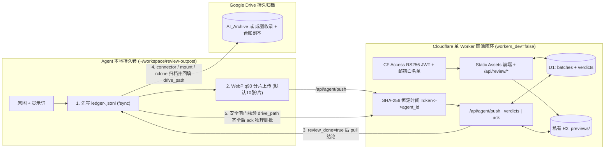

# 审图哨所 v4（Review Outpost v4）

审图哨所 v4 是一个面向高频 AI 生图工作流的**阅后即焚云端审图中转站**。各端 Agent（如跑在仅出站云端 VM 上的 `muse-main`、本地 Mac 上的 `argon-mac`）将原分辨率压缩预览图推送至在线审图台，审图人在电脑或手机浏览器上通过快捷键/触屏批量定档打标；Agent 拉回结论并在本地完成 Google Drive 原图归档后，通知云端整批物理清空预览图与数据库记录。

---

## 1. 项目概览与架构安全原则

### 1.1 四大核心架构与安全铁律

1. **云端阅后即焚，绝不做永久仓库**
   - Cloudflare 云端仅暂存原分辨率 WebP 预览图（`quality=90`）与审图定档结论。
   - Agent 消费结论并通过 `POST /api/agent/ack` 完成四桶计数核对后，云端**立即整批物理删除**该批次在 R2 中的全部预览对象及 D1 中的批次与结论记录。
2. **原图与提示词永不出本地，云端零网盘凭证**
   - 原始生图文件与生成提示词（Prompt）始终保存在各 Agent 所在机器的持久目录（如云端 VM 独立持久卷 `~/workspace/review-outpost`），**严禁使用 `/tmp`、`/var/tmp` 等临时目录或系统目录**。
   - 云端不存储任何原图、提示词，也不持有任何 Google Drive 凭证；云端预览图与本地原图仅通过全局唯一、终身不变的 `item_id` 关联。
3. **本地台账 `ledger-<agent_id>.jsonl` 是唯一持久真相**
   - 每个 Agent 在本地持久目录维护独立的 Append-Only 台账 `~/workspace/review-outpost/ledger-<agent_id>.jsonl`，每次追加均执行 `flush()` + `os.fsync()` 强制落盘。
   - **台账先行铁律**：`push` 前必须先将 `state="pushed"` 记录写入本地台账并落盘成功，随后才允许向云端上传预览图，顺序绝不可颠倒。
   - 云端 D1 仅作审图中转缓存；`ack` 删批后一切历史追溯、跨批修复复审（`round+1`）均以本地台账为准，且每次 `ack` 成功后将最新台账副本同步备份至 Google Drive 归档根目录。
4. **单 Worker Static Assets 同源安全闭环（零旁路裸奔）**
   - 前后端由**同一个 Cloudflare Worker** 同源承载：`wrangler.toml` 启用 `[assets]`（`directory = "./public"`, `binding = "ASSETS"`, `run_worker_first = true`），并强制设置 `workers_dev = false` 与 `preview_urls = false`，彻底关闭 `*.workers.dev` 默认子域入口。
   - **人机双通道纵深鉴权**：
     - **人侧（`/`、静态资源、`/api/review/*`）**：边缘由 Cloudflare Access 拦截验证个人邮箱登录（30 天会话），请求进入 Worker 后在 `run_worker_first = true` 机制下**二次强制验证** `Cf-Access-Jwt-Assertion` 的 RS256 签名（对比 Team JWKS 公钥）、`aud`、`exp/nbf` 及 `CF_ACCESS_ALLOWED_EMAILS` 邮箱白名单；验证通过后才流式读取私有 R2 预览图或转发 `env.ASSETS.fetch()`。即便误改边缘 Access 配置，Worker 内部依然拒绝未授权访问。
     - **机侧（`/api/agent/*`）**：边缘通过专用路径 `Bypass` 规则跳过浏览器登录跳转，直达 Worker 内由 `AGENT_TOKENS_JSON` 执行 Web Crypto SHA-256 摘要与**全量无短路恒定时间比对（Constant-Time Comparison）**，严格校验 `agent_id <-> token` 一对一绑定及批次归属隔离。
   - **全站防索引与禁缓存**：所有 HTML、静态文件、API 与预览图响应统一注入 `X-Robots-Tag: noindex, nofollow, noarchive` 与 `Cache-Control: private, no-store`，配合 `public/robots.txt` 与页面 `<meta name="robots">` 杜绝搜索引擎抓取。

### 1.2 系统流转架构图



### 1.3 全局 ID 与存储键规范

| 概念 | 格式规则 | 示例 | 说明 |
| :--- | :--- | :--- | :--- |
| `agent_id` | 短 slug，与机器令牌一对一绑定 | `muse-main` / `argon-mac` | 跨 Agent 批次严格隔离，不可越权读写 |
| `batch_id` | `<YYYYMMDD>-<agent_id>-<当日2位序号>` | `20261113-muse-main-02` | 未指定时由客户端按本地台账当日序号自动递增 |
| `item_id` | `<首推batch_id>-<3位序号>` | `20261113-muse-main-02-007` | **一张原图一个，终身不变**（跨批修复复审时保持原 `item_id`） |
| `round` | 正整数（首推为 `1`，修复重推 `+1`） | `1` -> `2` | D1 `verdicts` 表以 `(item_id, round)` 为联合主键 |
| R2 对象键 | `previews/<agent_id>/<batch_id>/<item_id>_r<round>.webp` | `previews/muse-main/20261113-muse-main-02/20261113-muse-main-02-007_r1.webp` | 仅存私有桶，经 Worker 鉴权后流式输出 |

---

## 2. 目录结构说明

```text
review-gallery/
├── wrangler.toml                     # 单 Worker 部署配置：Static Assets(run_worker_first=true)、D1、私有 R2、Cron、禁 workers.dev
├── package.json                      # TypeScript、Wrangler、Vitest 测试脚本与开发依赖
├── tsconfig.json                     # Worker 严格 TypeScript 编译配置
├── .dev.vars.example                 # 本地开发环境变量模板（全占位符，不含任何真实密钥）
├── .gitignore                        # 忽略 node_modules、.wrangler、.dev.vars、.test-sandboxes/ 等
├── migrations/
│   └── 0001_init.sql                 # D1 建表脚本（batches 表 + 含 filename/width/height/pushed_at 的 verdicts 表 + 索引）
├── src/                              # Cloudflare Worker 后端源码（TypeScript）
│   ├── index.ts                      # 统一入口：路由分发、run_worker_first 鉴权拦截、安全响应头注入、scheduled 定时清理
│   ├── types.ts                      # Env 绑定、D1 行模型与 API 请求/响应契约定义
│   ├── utils.ts                      # 统一 JSON 响应封装、防索引/禁缓存安全头附加与参数校验工具
│   ├── auth.ts                       # 双通道鉴权：CF Access RS256 JWT 验签 + Agent 令牌 SHA-256 恒定时间比对
│   ├── buckets.ts                    # 单图唯一归桶互斥优先级算法（H/F/O -> R -> tier 1/2/3 -> discarded）
│   ├── cleanup.ts                    # Cron 自动清理：未 ack 满 7 天删 R2 预览、满 30 天删 R2 + D1
│   └── routes/
│       ├── agent.ts                  # /api/agent/push（分片追加 & round+1 跨批）、/verdicts、/ack（409 严格核对与删批）
│       └── review.ts                 # /api/review/batches、详情、私有 R2 预览流式出图、定档打标、审完与撤回审完状态
├── public/                           # Workers Static Assets 纯静态前端（零构建步骤、零外部 CDN 依赖）
│   ├── robots.txt                    # 全站禁止搜索引擎抓取（Disallow: /）
│   ├── index.html                    # 审图台主页面（含 meta noindex、桌面/手机自适应骨架）
│   ├── styles.css                    # 暗色中性审图台样式、基于 width/height 的零抖动网格/瀑布流、移动端大触控栏
│   └── app.js                        # 前端交互：视图切换、原分辨率缩放平移灯箱、快捷键 1/2/3/H/F/O/R/N、撤回审完状态
├── agent/                            # Agent 侧本地客户端（兼容 Python 3.9+）
│   ├── hub_client.py                 # 核心 CLI：台账先行分片 push、pull(--watch)、archive-plan、mark-archived、安全闸门 ack
│   └── requirements.txt              # Python 依赖（仅 Pillow，用于生成原分辨率 q90 WebP 与读取宽高）
├── tests/                            # 全套本地离线自动化测试套件（零外部网络依赖，沙箱统一位于 .test-sandboxes/）
│   ├── worker/                       # Worker 离线单元测试（基于 node:sqlite + 内存 R2 + Web Crypto RS256）
│   ├── agent/                        # hub_client.py 离线闭环测试（先写台账、分片重试、安全闸门、mount/rclone、round+1、/tmp 拦截）
│   └── e2e/                          # 跨栈真实验收测试（真实 Worker HTTP 服务 + SQLite D1 + R2 + Python hub_client.py 子进程联调）
└── README.md                         # 部署、Zero Trust Access 配置、密钥注入与日常使用手册
```

---

## 3. Cloudflare 部署完整步骤

### 3.1 环境准备与登录

确保本地已安装 Node.js 22+，且你的主域名（例如 `<YOUR_DOMAIN>`，如 `example.com`）已托管在当前 Cloudflare 账号下：

```bash
npm install
npx wrangler login
```

### 3.2 创建私有 R2 存储桶（严禁开启公开访问）

创建用于暂存 WebP 预览图的 R2 桶（桶名需与 `wrangler.toml` 中 `[[r2_buckets]]` 的 `bucket_name` 一致，默认 `review-outpost-previews`）：

```bash
npx wrangler r2 bucket create review-outpost-previews
```

> [!CAUTION]
> **R2 安全红线**：
> 1. **严禁**在 Cloudflare 控制台为该桶开启 **Public Development URL (`r2.dev` 子域)**；
> 2. **严禁**为该桶直接绑定公开自定义域名（Custom Domains）或配置公开读取策略。
> 3. 存储桶必须保持 **100% 私有**，所有预览图仅允许 Worker 在验证 Cloudflare Access JWT 通过后经 `/api/review/previews/:batchId/:itemId/:round` 接口内部流式读取。

### 3.3 创建 D1 数据库

```bash
npx wrangler d1 create review-outpost-db
```

命令执行后终端会输出 `database_id`（UUID 格式，下文统一用 `<D1_DATABASE_ID>` 表示）。

### 3.4 回填 `wrangler.toml` 并绑定自定义域名路由

打开 `wrangler.toml`，将 `<D1_DATABASE_ID>` 回填至 `database_id`，取消注释 `routes` 并填入你的自定义子域名（例如 `review.<YOUR_DOMAIN>`，如 `review.example.com`），同时核对以下关键安全开关保持开启：

```toml
name = "review-outpost"
main = "src/index.ts"
compatibility_date = "2025-03-01"
workers_dev = false
preview_urls = false
assets = { directory = "./public", binding = "ASSETS", run_worker_first = true }

# 取消注释并替换为你在 Cloudflare 托管的自定义域名路由
routes = [
  { pattern = "review.<YOUR_DOMAIN>", custom_domain = true }
]

[triggers]
crons = ["0 4 * * *"]

[[r2_buckets]]
binding = "PREVIEWS_BUCKET"
bucket_name = "review-outpost-previews"

[[d1_databases]]
binding = "DB"
database_name = "review-outpost-db"
database_id = "<D1_DATABASE_ID>"
migrations_dir = "migrations"

[vars]
ENVIRONMENT = "production"
DEV_BYPASS_ACCESS = "false"
```

### 3.5 执行 D1 数据库建表迁移

分别对本地开发库（`--local`）与线上生产库（`--remote`）执行数据库迁移（`migrations/0001_init.sql`）：

```bash
# 本地开发 SQLite 库迁移（供 wrangler dev 本地联调使用）
npx wrangler d1 migrations apply review-outpost-db --local

# 线上生产 D1 库迁移（首次部署或表结构更新时执行）
npx wrangler d1 migrations apply review-outpost-db --remote
```

（亦可直接指定 SQL 文件执行：`npx wrangler d1 execute review-outpost-db --local --file=./migrations/0001_init.sql` 与 `--remote`。）

### 3.6 部署 Worker

完成第 4 节 Cloudflare Access 配置与第 5 节 Wrangler Secret 注入后，执行发布：

```bash
npx wrangler deploy
```

### 3.7 Cron Trigger 自动清理机制说明

`wrangler.toml` 配置了每日定时任务 `crons = ["0 4 * * *"]`（对应 `src/cleanup.ts`）：

- **正常情况**：Agent 执行 `ack` 后，该批次的 R2 预览与 D1 记录会**当场立即物理清空**。
- **超 7 天未 `ack` 批次**：自动删除该批在私有 R2 `previews/<agent_id>/<batch_id>/` 下的全部 WebP 预览图以释放存储空间，并在 `batches.previews_purged_at` 记录清理时间戳；**D1 中的定档结论继续保留**，防止 Agent 因离线错失结论。
- **超 30 天仍未 `ack` 批次**：兜底清理残留 R2 对象，并从 D1 `verdicts` 与 `batches` 表中彻底删除该批次记录。

---

## 4. Cloudflare Zero Trust (Access) 配置步骤（重点！）

必须在 Cloudflare Zero Trust 中配置**两个** Self-hosted Applications：**应用 A** 保护全站页面与审图接口（仅放行你的个人邮箱），**应用 B** 为 `/api/agent/*` 配置精确路径 `Bypass`（让 Agent 携带机器令牌直达 Worker 鉴权而不被网页登录页拦截）。

登录 [Cloudflare Zero Trust 控制台](https://one.dash.cloudflare.com/)：
- 先在 **Settings -> Custom Pages**（或 **Settings -> General**）查看并记下你的 **Team Domain**，格式为 `<YOUR_TEAM_NAME>.cloudflareaccess.com`。
- 在 **Settings -> Authentication -> Login methods** 确认已启用 **One-time PIN**（邮箱验证码登录）。

### 4.1 应用 A：审图页面与 `/api/review/*`（全站个人邮箱白名单）

1. 进入 **Access -> Applications** -> 点击 **Add an application** -> 选择 **Self-hosted**。
2. **Configure app（基础信息）**：
   - **Application name**：`Review Outpost Web`
   - **Session Duration**：选择 **`1 month` / `30 days (720h)`**（电脑与手机一次登录保持 30 天免重复验证）。
   - **Application domain** -> 点击 **Add public hostname**：
     - **Subdomain**：`review`
     - **Domain**：`<YOUR_DOMAIN>`（完整域名即 `review.<YOUR_DOMAIN>`）
     - **Path**：**留空**（覆盖整站 `/`、静态资源与 `/api/review/*`）。
3. **Add policies（添加访问策略）**：
   - **Policy name**：`Owner Email Allow`
   - **Action**：选择 **`Allow`**
   - **Session duration**：`Same as application session timeout`
   - **Configure rules -> Include**：
     - **Selector** 选择 **`Emails`**
     - **Emails** 填入你的个人邮箱：**`<YOUR_EMAIL>`**
4. 一路点击 Next -> **Add application** 保存。
5. 回到 Applications 列表，点开刚创建的 `Review Outpost Web`，在 **Overview** 标签页复制 **Application Audience (AUD) Tag**（记为 `<CF_ACCESS_AUD_TAG>`，第 5 节注入 Worker Secret 使用）。

### 4.2 应用 B：为 `/api/agent/*` 配置 Bypass 规则（必配精确步骤！）

> [!IMPORTANT]
> 如果未配置本条规则，Agent 脚本访问 `https://review.<YOUR_DOMAIN>/api/agent/push` 时会被应用 A 拦截并 `302` 重定向至 Cloudflare Access 网页邮箱登录界面，导致 CLI 请求失败。

1. 在同一个 **Zero Trust -> Access -> Applications** 页面，再次点击 **Add an application** -> 选择 **Self-hosted**。
2. **Configure app（基础信息）**：
   - **Application name**：`Review Outpost Agent API Bypass`
   - **Application domain** -> 点击 **Add public hostname**：
     - **Subdomain**：`review`
     - **Domain**：`<YOUR_DOMAIN>`（与上方应用 A 完全相同的域名 `review.<YOUR_DOMAIN>`）
     - **Path**：精确填写 **`api/agent/*`**（若控制台输入框带前导斜杠即为 `/api/agent/*`，覆盖 `/api/agent/push`、`/api/agent/verdicts`、`/api/agent/ack`）。
3. **Add policies（添加 Bypass 策略）**：
   - **Policy name**：`Bypass Edge Login for Agent Token Auth`
   - **Action**：必须选择 **`Bypass`**（切勿误选 `Allow` 或 `Block`！）
   - **Configure rules -> Include**：
     - **Selector** 选择 **`Everyone`**（勾选覆盖所有人，放行请求直达 Worker 内部鉴权层）。
4. 点击 Next -> **Add application** 保存生效。

### 4.3 双应用路径匹配与纵深安全原理解析

- **最长路径前缀优先匹配**：Cloudflare Access 在同一域名下按路径具体程度从长到短优先匹配应用：
  - 当 Agent 访问 `https://review.<YOUR_DOMAIN>/api/agent/*` 时，命中路径更具体的 **应用 B（`api/agent/*` -> `Bypass`）**，跳过浏览器邮箱验证码拦截，请求原样进入 Worker；Worker 内部立即读取 `Authorization: Bearer <TOKEN>`，使用 `AGENT_TOKENS_JSON` 执行 **SHA-256 摘要 + 全量无短路恒定时间比对** 反查绑定的 `agent_id`，并强制校验请求头 `X-Agent-Id`、表单 `manifest.agent_id` 与数据库批次 `agent_id` 完全一致，未带有效令牌一律返回 `401` / `403`。
  - 当审图人在浏览器访问 `/`、`/app.js`、`/styles.css` 或前端调用 `/api/review/*`（含预览图 `/api/review/previews/...`）时，不匹配 `api/agent/*`，命中覆盖全站的 **应用 A（`Allow` 个人邮箱）**。边缘验证通过后注入签名头 `Cf-Access-Jwt-Assertion`；由于 Worker 开启了 `run_worker_first = true`，Worker 会在任何静态资源或接口响应前，从 `https://<YOUR_TEAM_NAME>.cloudflareaccess.com/cdn-cgi/access/certs` 拉取公钥对 JWT 执行 **RS256 签名强校验**、核验 `aud` 与 `CF_ACCESS_AUD` 一致，并二次比对登录邮箱是否在 `CF_ACCESS_ALLOWED_EMAILS` 白名单中。**即使将来在控制台误改了边缘 Access 策略，没有合法签名 JWT 的任何请求依然会被 Worker 内核直接拦截（`401/403`），绝不会出现页面或预览图裸奔。**

---

## 5. 机器令牌生成与 Wrangler Secret 注入方法

> [!WARNING]
> **零密钥入库原则**：所有真实令牌、AUD Tag 与个人邮箱严禁写入代码仓库、配置文件或聊天记录，一律在本机终端生成并通过 `wrangler secret put` 加密注入。

### 5.1 为各 Agent 生成独立高熵令牌

在本地安全终端使用 OpenSSL 为 `muse-main`、`argon-mac` 各自生成独立的 32 字节（64 位十六进制）随机令牌，**一机一令、互不共用**：

```bash
# 1. 生成 muse-main 专用令牌（自行安全保存到 Muse VM 的环境变量中）
openssl rand -hex 32

# 2. 生成 argon-mac 专用令牌（自行安全保存到 Argon Mac 的环境变量中）
openssl rand -hex 32
```

### 5.2 使用 `wrangler secret put` 注入线上密钥

依次执行以下 4 条命令，按终端交互提示粘贴对应值（输入内容不会回显）：

1. **注入机器令牌映射表 `AGENT_TOKENS_JSON`**：
   ```bash
   npx wrangler secret put AGENT_TOKENS_JSON
   ```
   粘贴单行 JSON（将占位符替换为你刚用 `openssl rand -hex 32` 生成的各自独立令牌）：
   ```json
   {"muse-main":"<GENERATE_WITH_OPENSSL_RAND_HEX_32>","argon-mac":"<GENERATE_WITH_OPENSSL_RAND_HEX_32>"}
   ```

2. **注入应用 A 的 Audience Tag `CF_ACCESS_AUD`**：
   ```bash
   npx wrangler secret put CF_ACCESS_AUD
   ```
   粘贴第 4.1 节获取的 `<CF_ACCESS_AUD_TAG>`。

3. **注入 Zero Trust Team Domain `CF_ACCESS_TEAM_DOMAIN`**：
   ```bash
   npx wrangler secret put CF_ACCESS_TEAM_DOMAIN
   ```
   粘贴 `<YOUR_TEAM_NAME>.cloudflareaccess.com`（无需带 `https://`）。

4. **注入允许访问审图台的邮箱白名单 `CF_ACCESS_ALLOWED_EMAILS`**：
   ```bash
   npx wrangler secret put CF_ACCESS_ALLOWED_EMAILS
   ```
   粘贴 `<YOUR_EMAIL>`（如需授权多个本人邮箱，可用英文逗号分隔，如 `<YOUR_EMAIL_1>,<YOUR_EMAIL_2>`）。

注入完成后可运行 `npx wrangler secret list` 确认 4 个 Secret 名称均已就位。

---

## 6. Agent 客户端 (`agent/hub_client.py`) 使用手册

### 6.1 安装依赖与持久目录红线

`agent/hub_client.py` 兼容 Python 3.9+（macOS 自带 Python 3.9 与 Linux VM Python 3.10+ 均可直接运行），除标准库外仅依赖 `Pillow` 生成 WebP 预览图：

```bash
python3 -m pip install -r agent/requirements.txt
```

- **路径安全守卫**：默认工作目录为 `~/workspace/review-outpost`。客户端内置路径检查，**严禁将工作目录、台账、原图或挂载目标指向 `/tmp`、`/private/tmp`、`/var/tmp` 或 `/etc`、`/usr`、`/System` 等系统目录**，一旦检测到立即报错退出。

### 6.2 环境变量与配置项一览

建议在各 Agent 机器上用权限为 `600` 的环境文件管理以下变量（所有环境变量亦可通过同名 CLI 参数覆盖）：

| 环境变量 | 对应 CLI 参数 | 默认值 / 可选值 | 说明 |
| :--- | :--- | :--- | :--- |
| `OUTPOST_URL` | `--url` | （必填）如 `https://review.<YOUR_DOMAIN>` | 审图哨所线上（或本地调试）根地址 |
| `OUTPOST_AGENT_ID` | `--agent-id` | （必填）如 `muse-main` / `argon-mac` | 当前 Agent 唯一身份标识，须与令牌匹配 |
| `OUTPOST_TOKEN` | `--token` | （必填）`<GENERATE_WITH_OPENSSL_RAND_HEX_32>` | 当前 `agent_id` 专属机器令牌 |
| `OUTPOST_HOME` | `--workspace-dir` | `~/workspace/review-outpost` | 本地持久工作目录，存放 `ledger-<agent_id>.jsonl` 与 `_trash/` |
| `ARCHIVE_MODE` | `--archive-mode` | `connector`（可选 `connector` \| `mount` \| `rclone`） | 归档执行方式（详见 6.4 节） |
| `ARCHIVE_LAYOUT` | `--archive-layout` | `ai_archive`（可选 `ai_archive` \| `aigc_tier`） | Google Drive 归档目录布局：<ul><li>`ai_archive`：`AI_Archive/<agent_id>/<batch_id>/`（原图 + 同名 `.txt` 提示词成对入档）</li><li>`aigc_tier`：`aigc/成图收录/<YYYYMMDD>/<1-神图\|2-心动\|3-高品质>/`（附同名 `.txt` 提示词）</li></ul> |
| `DRIVE_MOUNT_ROOT` | `--mount-root` | 空（`mount` 模式必填） | 本地 Google Drive 桌面版挂载根目录（如 `~/Library/CloudStorage/GoogleDrive-<YOUR_EMAIL>/My Drive`） |
| `RCLONE_REMOTE` | `--rclone-remote` | 空（`rclone` 模式必填，如 `gdrive:`） | `rclone` 远端名称前缀（可通过 `RCLONE_BIN` 指定二进制路径，默认 `rclone`） |
| `MAX_REDRAW_ROUNDS` | — | `3` | 同提示词连续重抽（`R`）最大轮次阈值，超限后在台账记 `max_redraw_exceeded` 自动停手 |

### 6.3 单图唯一归桶互斥优先级表

Worker 后端（`src/buckets.ts`）、前端界面（`public/app.js`）与 Agent 客户端（`agent/hub_client.py`）严格执行同一套互斥归桶规则，确保每张图唯一落入四桶之一，恒满足 `pushed == archived + repair + redraw + discarded`：

| 优先级 | 判定条件 | 唯一归属桶 (`counts`) | 本地台账状态与后续动作 |
| :---: | :--- | :--- | :--- |
| **1（最高）** | `flags` 包含 `H`（修手指）、`F`（修脚）、`O`（其他局部修复）任一 | **`repair`**（待修复） | 记为 `state="repair"`。**哪怕同时打了档位（如 `tier=1` + `H`）也只计入 `repair`，绝不重复计入 `archived`**；D1 与本地台账 `verdict` 快照完整保留原 `tier`，供局部修好后 `round+1` 复审参考。 |
| **2** | 无 `H/F/O`，且 `flags` 包含 `R`（重抽） | **`redraw`**（待重抽） | 记为 `state="redraw"`。由 Agent 按原提示词重新生成；若同一脉络连续被标 `R` 达到 `MAX_REDRAW_ROUNDS`（默认 3 次），自动标记 `stop_reason="max_redraw_exceeded"` 停手。 |
| **3** | 无 `H/F/O/R` 标记，且 `tier` 为 `1` / `2` / `3` | **`archived`**（拟归档） | 记为 `state="archived"`（初始 `drive_path=null`）。必须将原图与同名提示词归档至 Google Drive 并回填 `drive_path` 后，安全闸门才放行 `ack`。 |
| **4（兜底）** | 无任何标记且 `tier` 为 `null` | **`discarded`**（淘汰/不收录） | 记为 `state="trashed"`。`pull` 落账时自动将原图移入 `<OUTPOST_HOME>/_trash/<batch_id>/`，同时自动清理 `_trash/` 下超过 7 天的旧文件。 |

### 6.4 三种归档模式实战流程

#### 模式一：`connector` 模式（Muse 云端 VM 默认）

云端 VM 不落地 Google OAuth 凭证，`hub_client.py` 负责生成归档计划并守住本地台账安全闸门，由 Agent 通过外部 Drive 连接器上传文件后回填 `drive_path`：

```bash
export OUTPOST_URL="https://review.<YOUR_DOMAIN>"
export OUTPOST_AGENT_ID="muse-main"
export OUTPOST_TOKEN="<GENERATE_WITH_OPENSSL_RAND_HEX_32>"
export OUTPOST_HOME="$HOME/workspace/review-outpost"
export ARCHIVE_MODE="connector"
export ARCHIVE_LAYOUT="ai_archive"

# 1. 推送原图目录（先写 ledger-muse-main.jsonl 并 fsync，再按默认 10 张/片上传 q90 WebP；自动读取同名 .txt 提示词）
python3 agent/hub_client.py push ~/workspace/outputs/20261113_run1/

# 2. 等待网页点击「审完本批」(review_done=true) 后拉回结论（也可用 --watch 轮询等待）
python3 agent/hub_client.py pull --batch 20261113-muse-main-01 --watch

# 3. 生成待上传 Google Drive 归档清单 JSON（列出每张 archived 原图、提示词及目标 Drive 路径）
python3 agent/hub_client.py archive-plan --batch 20261113-muse-main-01 > ~/workspace/review-outpost/plan-01.json

# 4. Agent 调用 Drive 连接器按清单上传原图与同名 .txt 提示词后，回填 drive_path 到本地台账
#    方式 A：单条回填
python3 agent/hub_client.py mark-archived \
  --batch 20261113-muse-main-01 \
  --item-id 20261113-muse-main-01-003 \
  --drive-path "AI_Archive/muse-main/20261113-muse-main-01/003.png"
#    方式 B：通过 JSON 文件批量回填（格式支持 [{"item_id": "...", "drive_path": "..."}] 或 {"<item_id>": "<drive_path>"}）
python3 agent/hub_client.py mark-archived \
  --batch 20261113-muse-main-01 \
  --from-json ~/workspace/review-outpost/uploaded-01.json

# 5. 发送 ack 通知云端核对计数并物理删批
#    【安全闸门】：若该批仍有任何 archived 条目的 drive_path 未回填，客户端会立即拒绝发送 ack（退出码非 0）并打印待上传清单！
python3 agent/hub_client.py ack --batch 20261113-muse-main-01

# 6. 通过 Drive 连接器将最新本地台账副本 ~/workspace/review-outpost/ledger-muse-main.jsonl 同步备份至 Drive 归档根目录（AI_Archive/ledger-muse-main.jsonl）
```

#### 模式二：`mount` 模式（Argon Mac 本地挂载盘全自动闭环）

在安装了 Google Drive 桌面版的 Mac 上，`hub_client.py` 可直接将原图与同名提示词复制入挂载盘、回填台账、触发云端 `ack` 删批，并自动把 `ledger-<agent_id>.jsonl` 备份同步至挂载盘归档根目录：

```bash
export OUTPOST_URL="https://review.<YOUR_DOMAIN>"
export OUTPOST_AGENT_ID="argon-mac"
export OUTPOST_TOKEN="<GENERATE_WITH_OPENSSL_RAND_HEX_32>"
export OUTPOST_HOME="$HOME/workspace/review-outpost"
export ARCHIVE_MODE="mount"
export ARCHIVE_LAYOUT="ai_archive"
export DRIVE_MOUNT_ROOT="$HOME/Library/CloudStorage/GoogleDrive-<YOUR_EMAIL>/My Drive"

# 1. 推送批次预览图
python3 agent/hub_client.py push ~/workspace/outputs/mac_batch_01/

# 2. 网页端点击「审完本批」后：拉取结论 + 一键执行挂载盘归档（原图 + 同名 .txt 提示词）、回填 drive_path、ack 云端删批，并自动同步 ledger-argon-mac.jsonl 到挂载盘归档根目录
python3 agent/hub_client.py pull --batch 20261113-argon-mac-01
python3 agent/hub_client.py archive-plan --batch 20261113-argon-mac-01 --execute
```

#### 模式三：`rclone` 模式（云端 VM 全自动升级项）

当后续希望将云端 VM 从半自动 `connector` 升级为全自动归档时，无需改动任何代码：

1. 在你自己的本地电脑执行 `rclone config` 创建名为 `gdrive` 的 Google Drive remote（使用本人 Google OAuth 登录授权），将生成的 `~/.config/rclone/rclone.conf` 安全拷贝至 VM 的 `~/.config/rclone/rclone.conf` 并设置 `chmod 600`。
2. 切换环境变量即可全自动运行（自动调用 `rclone copyto` 上传原图+提示词、回填 `drive_path`、调用 `ack` 删批，并将 `ledger-<agent_id>.jsonl` 备份至远端归档根目录）：
   ```bash
   export ARCHIVE_MODE="rclone"
   export RCLONE_REMOTE="gdrive:"

   python3 agent/hub_client.py pull --batch 20261113-muse-main-02
   python3 agent/hub_client.py archive-plan --batch 20261113-muse-main-02 --execute
   ```

### 6.5 `round+1` 修复复审跨批重推示例

对于上一批落入 `repair`（如 `H` 修手指 / `F` 修脚 / `O` 局部修复）的原图，Agent 在本地修复完成后推入**新批次**复审时，**必须保持原 `item_id` 终身不变**。客户端会自动从本地台账查找该 `item_id` 的历史最大轮次并令 `round = last_round + 1`、自动继承原提示词，D1 以 `(item_id, round)` 新增记录而不改动旧轮数据：

```bash
# 方式一：单张修复图跨批重推（原 item_id 保持 20261113-muse-main-01-007 不变，round 自动升为 2，挂入新批次 20261113-muse-main-02）
python3 agent/hub_client.py push \
  --batch 20261113-muse-main-02 \
  --repush-item 20261113-muse-main-01-007 \
  ~/workspace/repaired/007_hands_fixed.png

# 方式二：多张修复图通过映射文件（或内联 JSON）批量跨批重推（亦支持与新首推图片混编入同一新批次）
cat > ~/workspace/repaired/repush_map.json << 'EOF'
{
  "20261113-muse-main-01-007": "/home/agent/workspace/repaired/007_hands_fixed.png",
  "20261113-muse-main-01-012": "/home/agent/workspace/repaired/012_feet_fixed.png"
}
EOF

python3 agent/hub_client.py push \
  --batch 20261113-muse-main-02 \
  --repush-map ~/workspace/repaired/repush_map.json
```

对于落入 `redraw`（`R` 重抽）的图片，使用同提示词重新生成新图推送时可附加 `--redraw-from <orig_item_id>` 追踪连续重抽脉络，达到 `MAX_REDRAW_ROUNDS`（默认 3 次）时自动在台账标记停止重抽。

---

## 7. 审图页面操作与本地开发自测指南

### 7.1 审图页面功能与快捷键表

- **视图模式**：进入批次后可一键切换 **网格（Grid）** 与 **瀑布流（Masonry）** 布局；前端直接读取 D1 预存的 `width` / `height` 预设卡片 `aspect-ratio`，预览加载全程零跳动。
- **原分辨率大图灯箱**：点击放大或双击卡片进入灯箱，支持**鼠标滚轮缩放、触屏双指捏合/双击缩放、`适应屏幕` / `1:1 原大` / `+` / `-` 按钮以及放大后拖拽平移**，便于 1:1 检查手指与局部细节。
- **手机端单手触控**：屏幕底部常驻大热区触控操作坞，点击即可完成全部定档、打标、备注与上下张切换。
- **「审完本批」与「撤回审完状态」**：
  - 顶部状态栏实时统计 `已判数 / 总数` 及四桶预计去向（`归档 / 修复 / 重抽 / 淘汰`）。
  - 点击 **「审完本批」** 后批次置为 `review_done = true` 并锁定编辑，允许 Agent 拉取正式结论与 `ack`。
  - **误判反悔机制**：在 Agent 尚未执行 `ack` 删批前，可随时点击顶部 **「撤回审完状态」**（发送 `{ "review_done": false }`）重新解锁批次继续修改，改完再次点击「审完本批」即可。

| 快捷键 / 交互 | 作用 | 详细行为说明 |
| :---: | :--- | :--- |
| `1` | **1档 · 神图** | 设为 1 档；若当前已是 1 档，**再按一次 `1` 取消定档**（置回 `null`） |
| `2` | **2档 · 心动** | 设为 2 档；再按一次 `2` 取消定档 |
| `3` | **3档 · 高品质** | 设为 3 档；再按一次 `3` 取消定档 |
| `H` | **修手指** 标记 | 可自由叠加/取消，与 `1/2/3` 档位独立共存（共存时归入 `repair` 并保留原档位） |
| `F` | **修脚** 标记 | 可自由叠加/取消，与档位独立共存 |
| `O` | **其他局部修复** 标记 | 可自由叠加/取消，与档位独立共存 |
| `R` | **重抽** 标记 | 同提示词重新生成标记（未含 `H/F/O` 时归入 `redraw`） |
| `N` | **写备注** | 打开当前图片的文本备注框（输入框聚焦时自动屏蔽单字母快捷键；支持浏览器可选语音转文字） |
| `←` / `→` | **上一张 / 下一张** | 在网格/瀑布流中移动选中卡片，在灯箱中无缝切换前后大图 |
| `滚轮` / `拖拽` | **缩放 / 平移大图** | 灯箱模式下查看局部高清细节 |
| `Esc` | **关闭弹窗 / 退出灯箱** | 关闭备注编辑框或返回批次列表视图 |

### 7.2 本地开发 `.dev.vars` 配置与启动

1. 基于模板创建本地环境变量文件 `.dev.vars`（已在 `.gitignore` 忽略，切勿提交）：
   ```bash
   cp .dev.vars.example .dev.vars
   ```
2. 编辑 `.dev.vars`（模板默认 `DEV_BYPASS_ACCESS="false"`；如需在本地浏览器免 Access JWT 联调页面，可显式改为 `"true"`，以下全部为占位符）：
   ```ini
   ENVIRONMENT="development"
   DEV_BYPASS_ACCESS="true"
   CF_ACCESS_TEAM_DOMAIN="<YOUR_TEAM>.cloudflareaccess.com"
   CF_ACCESS_AUD="<CF_ACCESS_APPLICATION_AUD_TAG>"
   CF_ACCESS_ALLOWED_EMAILS="<YOUR_EMAIL>"
   AGENT_TOKENS_JSON='{"muse-main":"<GENERATE_WITH_OPENSSL_RAND_HEX_32>","argon-mac":"<GENERATE_WITH_OPENSSL_RAND_HEX_32>"}'
   ```
   > [!NOTE]
   > **本地开发免 Access 开关安全约束**：Worker 仅在 `ENVIRONMENT === "development"` **且** `DEV_BYPASS_ACCESS === "true"` **两个条件同时满足**时，才允许本地浏览器在不携带 `Cf-Access-Jwt-Assertion` 的情况下访问页面与 `/api/review/*` 接口。`wrangler.toml` 生产 `[vars]` 固定为 `ENVIRONMENT = "production"` 与 `DEV_BYPASS_ACCESS = "false"`，线上环境切勿开启 `DEV_BYPASS_ACCESS`。

3. 初始化本地 SQLite D1 表结构并启动本地服务：
   ```bash
   npx wrangler d1 migrations apply review-outpost-db --local
   npm run dev
   ```

### 7.3 全套离线自动化测试命令

所有测试套件均在本地 100% 离线运行，无任何外部网络依赖，测试沙箱统一创建在仓库内 `.test-sandboxes/` 下（严格禁止读写 `/tmp`）：

```bash
# 1. Worker TypeScript 严格类型检查
npx tsc --noEmit

# 2. Worker 后端离线单元测试（覆盖 RS256 Access JWT 验签、SHA-256 恒定时间令牌鉴权、分片追加、round+1 跨批、互斥归桶、ack 409 与删批、7/30 天 Cron 清理）
npm test

# 3. Python Agent 客户端离线闭环测试（覆盖先写台账、10 张分片与局部重试、connector 安全闸门拦截、mount/rclone 自动归档与台账备份、round+1 跨批重推、/tmp 路径拒绝）
python3 -m unittest discover -s tests/agent -v

# 4. 跨栈端到端（E2E）真实验收测试（启动真实 Worker + SQLite D1 + 内存 R2 + Web Crypto JWKS 验签，由真实 hub_client.py 子进程走完 5 项验收闭环）
npx tsx tests/e2e/run_e2e.mjs
```
