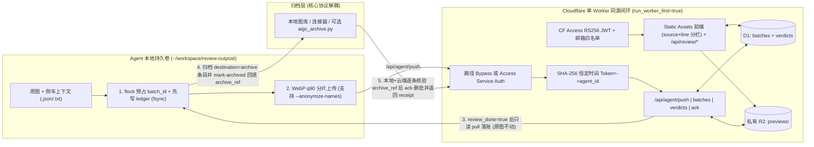

# 审图哨所 v4（Review Outpost v4）

审图哨所 v4 是一个面向多管线高频 AI 生图工作流的**阅后即焚云端审图中转站**。各端 Agent（如云端 VM 上的 `muse-main`、本地工作站上的 `argon-mac`）按 `source × line` 通道将原分辨率压缩预览图推送至在线审图台，审图人在桌面或手机浏览器上按四档星级（`★★★ / ★★ / ★ / ☆`）与正交标记（`H / F / O / R`）批量快速判图；Agent 只读拉回结论、完成本地或远端归档并回填通用凭据 `archive_ref` 后，调用 `ack` 逐条核验清空云端整批预览图与数据库记录。

[](https://deploy.workers.cloudflare.com/?url=https://github.com/Daiobs/review-gallery)

> **部署与自动迁移说明**：
> - 点击上方按钮可将本仓库克隆至你的 GitHub 账号、按 `wrangler.toml` 自动创建私有 R2 桶与 D1 数据库并引导配置 `.dev.vars.example` 中的 4 项生产 Worker Secret。
> - 本项目 `wrangler.toml` 已开启 `workers_dev = true`（同时保留 `preview_urls = false` 与 `[assets] run_worker_first = true`），且 `package.json` 的 `deploy` 脚本配置为 `CI=true wrangler d1 migrations apply DB --remote && wrangler deploy`：推送到 GitHub 主分支触发 **Cloudflare Workers Builds** 时，会自动按序执行远端 D1 迁移（`0001_init.sql` + `0002_v4_upgrade.sql`）并发布最新 Worker。
> - 上线后请务必按本文 **第 4 节** 完成 Cloudflare Zero Trust (Access) 边缘鉴权配置（支持 **自定义域名 `/api/agent/*` Bypass** 或 **`*.workers.dev` 全站 Access + Service Auth 服务令牌** 两种形态），并按 **第 5 节** 为各 Agent 生成独立高熵令牌注入 `AGENT_TOKENS_JSON`。

---

## 1. 项目概览、核心业务语义与安全原则

### 1.1 四大核心架构与安全铁律

1. **云端阅后即焚，绝不做永久仓库**
   - Cloudflare 云端仅暂存原分辨率 WebP 预览图（`quality=90`）与审图结论。
   - Agent 消费结论并通过 `POST /api/agent/ack` 完成全量条目覆盖核对与 `archive_ref` 非空校验后，云端**立即整批物理删除**该批在 R2 中的全部预览对象及 D1 中的批次与结论记录，并返回分类回执 `receipt`。
2. **核心协议彻底去网盘化，原图与生成上下文永不出本地**
   - 原始生图文件、提示词与完整生成上下文（`generation_context`）始终保存在各 Agent 本地持久目录（默认 `~/workspace/review-outpost`），**严禁使用 `/tmp`、`/var/tmp` 等临时目录或系统目录**，绝不上传云端，云端也不持有任何网盘凭证。
   - **纯只读拉取与归档解耦**：`hub_client.py pull` 仅将云端结论追加写入本地台账，**绝不移动、删除或改写本地原图与侧车文件**；核心协议仅通过非空字符串 `archive_ref` 核验归档完成状态，不耦合任何网盘或挂载路径（需要 `rclone` 自动归档至 Google Drive 的节点可按需选用解耦模块 `agent/aigc_archive.py`）。
3. **本地台账 `ledger-<agent_id>.jsonl` 是唯一持久真相**
   - 每个 Agent 在本地持久目录维护独立的 Append-Only 台账 `~/workspace/review-outpost/ledger-<agent_id>.jsonl`，每次追加均强制 `flush()` + `os.fsync()` 落盘。
   - **原子预占与台账先行**：自动生成批次号时先通过 `<ledger_path>.lock`（`fcntl.flock` 排他锁）写入 `batch_reserved` 预占事件防并发撞号；编码预览后必须先将 `state="pushed"` 记录落盘，随后才向云端分片上传。
   - 云端 D1 仅作审图中转缓存；删批后一切历史追溯、来源血统（`parent_item_id`）及星级切流兼容（`cutover_v4_star_scale`）均以本地台账为准。
4. **单 Worker Static Assets 同源安全闭环（零旁路裸奔）**
   - 前后端由**同一个 Cloudflare Worker** 同源承载：`assets = { directory = "./public", binding = "ASSETS", run_worker_first = true }` + `preview_urls = false`。所有页面与静态资源请求均先进入 Worker 鉴权层，通过后才调用 `env.ASSETS.fetch()`。
   - **人机双通道纵深鉴权**：
     - **人侧（`/`、静态资源、`/api/review/*`）**：边缘由 Cloudflare Access 拦截验证个人邮箱登录（30 天会话），进入 Worker 后**二次强制验证** `Cf-Access-Jwt-Assertion` 的 RS256 签名（对比 Team JWKS 公钥）、`aud`、`exp/nbf` 及 `CF_ACCESS_ALLOWED_EMAILS` 邮箱白名单。即使边缘规则误配，无合法签名 JWT 的请求依然被 Worker 内核直接拒绝（`401/403`）。
     - **机侧（`/api/agent/*`）**：边缘支持自定义域名路径 `Bypass` 或 `*.workers.dev` Access `Service Auth`（自动携带 `CF-Access-Client-Id` / `CF-Access-Client-Secret` 穿透边缘），进入 Worker 后由 `AGENT_TOKENS_JSON` 执行 Web Crypto SHA-256 摘要与**全量无短路恒定时间比对**，严格校验 `agent_id <-> token` 一对一绑定及批次归属隔离。
   - **全站防索引与禁缓存**：全响应统一附加 `X-Robots-Tag: noindex, nofollow, noarchive` 与 `Cache-Control: private, no-store`，配合 `public/robots.txt` 与 HTML `<meta name="robots">` 杜绝搜索引擎抓取。

### 1.2 新四档星级刻度与按键解耦（`tier = 3 / 2 / 1 / 0`）

全栈统一采用**「存储数值 = 星数」**的四档星级刻度，左手键盘快捷键保持降序 **`1 / 2 / 3 / 4`** 不变，并根据批次类型 `batch_type` 自动切换显示词典：

| 左手快捷键 | 存储数值 `tier` | 星级符号 | `batch_type = "artwork"`（成图） | `batch_type = "face" \| "outfit"`（脸模 / 服装） |
| :---: | :---: | :---: | :--- | :--- |
| `1` | **`3`** | `★★★` | 神图 | 核心锚 |
| `2` | **`2`** | `★★` | 心动 | 优质锚 |
| `3` | **`1`** | `★` | 高品质 | 达标锚 |
| `4` | **`0`** | `☆` | 收藏 | 留样 |
| 未定档 | **`null`** | — | — | — |

- 再按一次当前已激活的快捷键则取消定档（置回 `null`）；不用 `0` 键做定档（灯箱模式下 `0` 键保持「适应屏幕」缩放）。
- **全栈防吞 `0` 红线**：`tier = 0`（`☆ 收藏 / 留样`）是合法有效的正式入库档位！TypeScript、前端 JS 与 Python 客户端全链路统一以 `tier !== null && tier !== undefined`（Python `tier is not None`）判定是否已定档，严禁将 `0` 当作空值丢弃。

### 1.3 单图结论正交规则（互斥主去向 `destination` + 旁路开关 `redraw`）

每张图片的审图结论由 `tier`（`3 | 2 | 1 | 0 | null`）与 `flags`（`H` 修手指 / `F` 修脚 / `O` 其他局部修复 / `R` 重抽）共同决定，拆分为正交两维：

1. **互斥主去向 `destination ∈ {"archive", "repair", "discard"}`**（每张图必居其一，全批恒满足 `archive + repair + discard === pushed_count`）：
   | 优先级 | 判定条件 | 主去向 `destination` | 业务含义与台账字段 |
   | :---: | :--- | :--- | :--- |
   | **1（最高）** | `flags` 包含 `H`、`F`、`O` 任一 | **`"repair"`**（待修复） | 候选待定，本轮不归档入库；若同时打了星级 `tier`，该星级作为**意向档 `intent_tier`** 保存在记录中供修复复审参考（`final_tier = null`）。 |
   | **2** | 无 `H/F/O`，且 `tier !== null`（`0\|1\|2\|3`） | **`"archive"`**（拟归档） | 正式入库（`final_tier = tier`）；调用 `ack` 前必须回填非空归档凭据 `archive_ref`。 |
   | **3（兜底）** | 无 `H/F/O`，且 `tier === null` | **`"discard"`**（不收录） | 原图不入库（`final_tier = null`）。 |

2. **独立旁路重抽开关 `redraw = flags.includes("R")`**（与 `destination` 完全正交叠加，互不覆盖）：
   - **`archive + redraw`**（如 `tier=3 + R`）：原图按 `★★★` 正常入库归档，同时生成一条带完整生成上下文的重抽待办；前端徽章显示 `★★★ 神图 · 重抽`，在「拟归档」与「待重抽」筛选下**均可见**。
   - **`repair + redraw`**（如 `tier=3 + H + R`）：原图进入待修复队列（保留意向档 `★★★`），同时生成重抽待办；前端徽章显示 `待修复(意向★★★) · H · 重抽`，在「待修复」与「待重抽」下**均可见**。
   - **`discard + redraw`**（仅 `R`，无 `tier` 无 `H/F/O`）：原图不收，仅生成一条重抽待办；前端徽章显示 `仅重抽（原图不收）`，在「不收录」与「待重抽」下**均可见**。

### 1.4 动态通道顶栏（`source × line`）、防撞号批次 ID 与来源血统

| 概念 | 格式规则 | 示例 | 说明 |
| :--- | :--- | :--- | :--- |
| `agent_id` | 机器身份 slug，与令牌一对一绑定 | `muse-main` / `argon-mac` | 仅负责鉴权与批次归属隔离；单机单令牌可推送多条管线 |
| `source` | 工作台 slug（未传按 `agent_id` 自动映射兜底） | `museai` / `gallery` | 默认映射：`muse-main -> museai`，`argon-mac -> gallery` |
| `line` | 生图管线 slug（可选，空值存 `NULL`） | `gpt` / `colab` / `banana` | 服务端仅校验安全 slug，新管线零配置动态出现在前端顶栏 |
| `channel_id` | `${source}-${line}`（无 `line` 时为 `${source}`） | `gallery-banana` / `museai-gpt` | 前端批次列表页顶部按 `channel_id` 动态分栏并统计未审完数 |
| `batch_type` | `artwork` \| `face` \| `outfit`（兼容 `成图/脸模/服装`） | `artwork`（默认） | 决定前端四档星级标签词典及下游归档路由 |
| `batch_id` | `<YYYYMMDD>-<source>-<line>-<2位序号>` | `20261119-gallery-banana-01` | 无 `line` 时为 `<YYYYMMDD>-<source>-<2位序号>`；由 `flock` 锁原子预占 |
| `item_id` | `<首推batch_id>-<3位序号>` | `20261119-gallery-banana-01-001` | 一张图一个唯一标识；支持 `round+1` 同 ID 跨批复审 |
| `parent_item_id` | 来源父图 `item_id`（可选安全 slug） | `20261118-gallery-banana-02-005` | 记录重抽衍生或修复新图血统，前端展示 `源自 <parent_item_id>` |
| R2 对象键 | `previews/<agent_id>/<batch_id>/<item_id>_r<round>.webp` | `previews/argon-mac/20261119-gallery-banana-01/...` | 仅存私有 R2 桶，经 Worker 鉴权后流式输出 |

### 1.5 系统流转架构图



---

## 2. 目录结构说明

```text
review-gallery/
├── wrangler.toml                          # 单 Worker 配置：Static Assets(run_worker_first=true)、workers_dev=true、D1、私有 R2、Cron
├── package.json                           # 构建测试脚本；deploy 集成远端 D1 自动迁移 + wrangler deploy
├── tsconfig.json                          # Worker 严格 TypeScript 编译配置
├── .dev.vars.example                      # 生产 Worker Secret 提示模板与本地开发覆写注释说明（零真实密钥）
├── .gitignore                             # 忽略 node_modules、.wrangler、.dev.vars、.test-sandboxes/ 等
├── migrations/
│   ├── 0001_init.sql                      # 初始建表脚本（batches + verdicts 基础结构）
│   └── 0002_v4_upgrade.sql                # v4 升级迁移（source/line/batch_type/review_done_at、tier 0..3、parent_item_id、存量 1↔3 翻正）
├── src/                                   # Cloudflare Worker 后端源码（TypeScript）
│   ├── index.ts                           # 统一入口：路由分发、run_worker_first 鉴权拦截、防索引响应头、scheduled 清理
│   ├── types.ts                           # Env 绑定、D1 行模型、TierValue(3|2|1|0|null) 与 API 契约定义
│   ├── utils.ts                           # 统一 JSON 响应、安全响应头注入与 slug / 参数校验工具
│   ├── auth.ts                            # 双通道鉴权：CF Access RS256 JWT 验签 + Agent 令牌 SHA-256 恒定时间比对
│   ├── buckets.ts                         # 单图正交结论计算（resolveDisposition: archive/repair/discard + redraw）与批次统计
│   ├── cleanup.ts                         # Cron 自动清理：未 ack 满 7 天删 R2 预览保留结论、满 30 天删 R2 + D1
│   └── routes/
│       ├── agent-types.ts                 # Agent 路由内部辅助类型定义
│       ├── agent.ts                       # /api/agent/push、/batches、/verdicts、/ack（逐条覆盖 + archive_ref 校验并返回 receipt）
│       └── review.ts                      # /api/review/batches（含通道聚合）、详情、R2 流式出图、打标定档、审完与撤回审完
├── public/                                # Workers Static Assets 纯静态前端（零构建步骤、零外部 CDN 依赖）
│   ├── robots.txt                         # 全站禁止抓取（Disallow: /）
│   ├── index.html                         # 审图台主页面（含 meta noindex、动态通道顶栏、桌面/手机自适应结构）
│   ├── styles.css                         # 暗色中性审图台样式、基于 width/height 的零抖动网格/瀑布流、移动端大触控坞
│   └── app.js                             # 前端交互：source×line 通道栏、1/2/3/4 四档星级与词典切换、正交分桶筛选、1:1 缩放灯箱
├── agent/                                 # Agent 侧本地客户端与工具（兼容 Python 3.9+）
│   ├── hub_client.py                      # 核心去网盘化 CLI：push(flock预占/盲审脱敏/血统)、batches、只读 pull、mark-archived、ack
│   ├── migrate_v4_cutover.py              # v4 切流迁移工具：mark-ledger 台账分界线打标、flip-star-table 星级表原子 1↔3 翻转
│   ├── aigc_archive.py                    # [可选解耦模块] 基于 rclone 的 Google Drive 四档路由自动归档、组合卡生成与台账备份
│   ├── aigc_archive_config.example.json   # [可选解耦模块] Drive 成图/脸模/服装四档目录路由配置模板
│   └── requirements.txt                   # Python 依赖（仅 Pillow，用于生成原分辨率 q90 WebP 与读取宽高）
├── tests/                                 # 全套本地离线自动化测试套件（零外网依赖，沙箱统一位于 .test-sandboxes/）
│   ├── worker/                            # Worker 离线单测（含 0001->0002 迁移翻正、tier=0 防吞、正交分桶、逐条 ack 409/200、Cron）
│   ├── agent/                             # Python 客户端离线单测（只读 pull、并发 flock、脱敏、Service Auth 头、cutover、可选归档）
│   └── e2e/                               # 跨栈真实验收测试（真实 Worker HTTP + SQLite D1 + 内存 R2 + hub_client.py 子进程闭环）
└── README.md                              # 部署、双形态 Access 配置、密钥注入与日常使用手册
```

---

## 3. Cloudflare 部署与 CI/CD 自动发布流程

### 3.1 持续交付主路径：GitHub 推送触发 Cloudflare Workers Builds

本项目推荐通过 **GitHub 仓库推送 -> Cloudflare Workers Builds** 自动完成数据库迁移与 Worker 发布（无需在本机手动执行 `wrangler deploy`）：

- `package.json` 中的部署命令已配置为：
  ```json
  "deploy": "CI=true wrangler d1 migrations apply DB --remote && wrangler deploy"
  ```
- 每次将代码合并或推送至 `main` 分支时，Cloudflare Workers Builds 会自动：
  1. 按字典序检查并执行 `migrations/` 下尚未应用的 SQL 迁移（首次建表 `0001_init.sql` 及 v4 升级迁移 `0002_v4_upgrade.sql`，幂等跳过已执行项）；
  2. 将最新 Worker 后端代码与 `./public` 静态前端同源打包发布上线。

### 3.2 新环境从零初始化步骤（自建参考）

如果是全新 Cloudflare 账号首次手动初始化资源：

1. **安装依赖并登录**：
   ```bash
   npm install
   npx wrangler login
   ```
2. **创建私有 R2 存储桶（严禁开启公开访问）**：
   ```bash
   npx wrangler r2 bucket create review-outpost-previews
   ```
   > [!CAUTION]
   > **R2 安全红线**：严禁开启 **Public Development URL (`r2.dev` 子域)**，严禁为 R2 桶直接绑定公开自定义域名！存储桶必须保持 **100% 私有**，所有预览图仅经 Worker 校验 Access JWT 后由 `/api/review/previews/:batchId/:itemId/:round` 内部流式输出。

3. **创建 D1 数据库并核对 `wrangler.toml`**：
   ```bash
   npx wrangler d1 create review-outpost-db
   ```
   将输出的 `database_id` 回填至 `wrangler.toml`（若需绑定自定义域名，同步取消 `routes` 注释）：
   ```toml
   name = "review-outpost"
   main = "src/index.ts"
   compatibility_date = "2025-03-01"
   workers_dev = true
   preview_urls = false
   assets = { directory = "./public", binding = "ASSETS", run_worker_first = true }

   # 如使用自定义域名，取消下方注释并替换为你的域名：
   # routes = [
   #   { pattern = "review.<YOUR_DOMAIN>", custom_domain = true }
   # ]

   [triggers]
   crons = ["0 4 * * *"]

   [[r2_buckets]]
   binding = "PREVIEWS_BUCKET"
   bucket_name = "review-outpost-previews"

   [[d1_databases]]
   binding = "DB"
   database_name = "review-outpost-db"
   database_id = "<D1_DATABASE_ID>"
   migrations_dir = "migrations"

   [vars]
   ENVIRONMENT = "production"
   DEV_BYPASS_ACCESS = "false"
   ```

4. **执行本地或远端 D1 迁移**：
   ```bash
   # 本地开发 SQLite 库执行全部迁移（0001 + 0002）
   npx wrangler d1 migrations apply DB --local

   # 远端生产 D1 库执行迁移（Workers Builds CI 会自动执行本命令）
   CI=true npx wrangler d1 migrations apply DB --remote
   ```

### 3.3 Cron Trigger 自动过期清理机制

`wrangler.toml` 配置了每日定时任务 `crons = ["0 4 * * *"]`（`src/cleanup.ts`）：
- **正常流转**：Agent 执行 `ack` 通过后，该批 R2 预览与 D1 记录**当场立即物理清空**。
- **超 7 天未 `ack` 批次**：自动删除该批在私有 R2 `previews/<agent_id>/<batch_id>/` 下的全部预览图并记录 `previews_purged_at`，**继续保留 D1 结论**供离线恢复的 Agent 补拉。
- **超 30 天仍未 `ack` 批次**：兜底清理残留 R2 对象，并从 D1 `verdicts` 与 `batches` 表中彻底删除该批次记录。

---

## 4. Cloudflare Zero Trust (Access) 边缘鉴权配置（两种受支持形态）

登录 [Cloudflare Zero Trust 控制台](https://one.dash.cloudflare.com/)，先在 **Settings -> Custom Pages / General** 记下你的 **Team Domain**（`<YOUR_TEAM>.cloudflareaccess.com`），并确保 **Settings -> Authentication -> Login methods** 已启用 **One-time PIN**。

根据你访问审图台所使用的入口域名，任选以下一种边缘鉴权形态配置（**无论哪种形态，Worker 内部均会二次强校验人侧 RS256 Access JWT 与机侧 SHA-256 恒定时间 Bearer Token**）：

### 4.1 形态一：自定义域名形态（`review.<YOUR_DOMAIN>`，双应用路径 Bypass）

适合绑定了自定义域名（如 `review.example.com`）的场景，通过两个 Self-hosted Application 按最长路径前缀分流人机流量：

1. **应用 A（保护审图页面与 `/api/review/*`）**：
   - 进入 **Access -> Applications -> Add an application -> Self-hosted**。
   - **Application name**：`Review Outpost Web`，**Session Duration**：`1 month / 30 days (720h)`。
   - **Application domain**：Subdomain = `review`，Domain = `<YOUR_DOMAIN>`，**Path 留空**（覆盖全站）。
   - **Policy**：Action = **`Allow`**，Include 规则选择 **`Emails`** = `<YOUR_EMAIL>`。
   - 保存后在 Overview 页复制 **Application Audience (AUD) Tag**（记为 `<CF_ACCESS_APPLICATION_AUD_TAG>`）。
2. **应用 B（为 `/api/agent/*` 放行边缘登录页跳转）**：
   - 在同一页面再次点击 **Add an application -> Self-hosted**。
   - **Application name**：`Review Outpost Agent API Bypass`。
   - **Application domain**：Subdomain = `review`，Domain = `<YOUR_DOMAIN>`，**Path** 精确填写 **`api/agent/*`**（或 `/api/agent/*`）。
   - **Policy**：Action 选择 **`Bypass`**，Include 选择 **`Everyone`**。
   - **原理**：Cloudflare Access 按最长路径前缀优先匹配，Agent 请求 `/api/agent/*` 命中应用 B 跳过网页验证码拦截，直达 Worker 内由 `AGENT_TOKENS_JSON` 完成恒定时间令牌鉴权；浏览器访问 `/`、静态资源与 `/api/review/*` 命中应用 A 并在 Worker 内二次校验 `Cf-Access-Jwt-Assertion` RS256 签名与邮箱白名单。

### 4.2 形态二：`*.workers.dev` 全站 Access 保护形态（Service Auth 服务令牌穿透）

适合直接使用 `https://review-outpost.<YOUR_SUBDOMAIN>.workers.dev`（或单应用全站保护域名）的场景：

1. **生成机器侧 Access 服务令牌（Service Token）**：
   - 进入 **Zero Trust -> Access -> Service Auth -> Service Tokens**，点击 **Create Service Token**。
   - 命名为 `review-outpost-agents`，有效期按需选择，复制仅显示一次的 **`Client ID`** 与 **`Client Secret`**（安全保存到 Agent 机器本地环境变量，切勿写入仓库）。
2. **配置全站 Self-hosted Application 与双策略**：
   - 进入 **Access -> Applications -> Add an application -> Self-hosted**，绑定你的 `review-outpost.<YOUR_SUBDOMAIN>.workers.dev`（Path 留空覆盖全站），Session Duration 设为 `30 days (720h)`，记下该应用的 **AUD Tag**。
   - **策略 1（人侧邮箱登录）**：Action = **`Allow`**，Include `Emails = <YOUR_EMAIL>`。
   - **策略 2（机侧服务令牌放行）**：Action = **`Service Auth`**（Non-Identity），Include 选择 **`Service Token`** = `review-outpost-agents`。
3. **Agent 客户端自动注入双请求头**：
   - 在 Agent 机器环境变量中配置 `CF_ACCESS_CLIENT_ID` 与 `CF_ACCESS_CLIENT_SECRET`（或传 CLI 参数 `--cf-access-client-id` / `--cf-access-client-secret`）。
   - `agent/hub_client.py` 检测到这两个值非空时，会自动在所有 `/api/agent/*` 请求头中附带 `CF-Access-Client-Id` 与 `CF-Access-Client-Secret` 穿透边缘 Access 网关，进入 Worker 后继续由 `Authorization: Bearer <OUTPOST_TOKEN>` 完成 `agent_id <-> token` 隔离鉴权。

---

## 5. 机器令牌生成与 Wrangler Secret 注入方法

> [!WARNING]
> **零密钥入库原则**：所有真实机器令牌、Access 服务令牌、AUD Tag 与个人邮箱严禁写入代码仓库、配置文件或提交记录，一律在本机终端生成并通过 `wrangler secret put`（或 Cloudflare Dashboard Worker Settings -> Variables and Secrets）加密注入。

### 5.1 为各 Agent 生成独立高熵令牌

在本地终端使用 OpenSSL 为每个 `agent_id` 生成独立的 32 字节（64 位十六进制）随机令牌，**一机一令、互不共用**：

```bash
# 生成 muse-main 专用令牌
openssl rand -hex 32

# 生成 argon-mac 专用令牌
openssl rand -hex 32
```

### 5.2 注入 4 项生产 Worker Secret

依次执行以下 4 条命令并按交互提示粘贴对应值（`CF_ACCESS_CLIENT_ID` / `CF_ACCESS_CLIENT_SECRET` 属于客户端侧环境变量，**不需要**注入 Worker Secret）：

```bash
# 1. 注入机器令牌映射表（单行 JSON：{"muse-main":"<HEX_32>","argon-mac":"<HEX_32>"}）
npx wrangler secret put AGENT_TOKENS_JSON

# 2. 注入第 4 节全站 Access 应用的 Application Audience (AUD) Tag
npx wrangler secret put CF_ACCESS_AUD

# 3. 注入 Zero Trust Team Domain（格式：<YOUR_TEAM>.cloudflareaccess.com，不带 https://）
npx wrangler secret put CF_ACCESS_TEAM_DOMAIN

# 4. 注入审图人允许登录的个人邮箱白名单（多个邮箱用英文逗号分隔）
npx wrangler secret put CF_ACCESS_ALLOWED_EMAILS
```

---

## 6. 客户端 (`agent/hub_client.py`)、切流工具与可选归档模块

### 6.1 安装依赖与持久目录红线

`agent/hub_client.py` 兼容 Python 3.9+，除标准库外仅依赖 `Pillow` 进行原分辨率 WebP q90 编码：

```bash
python3 -m pip install -r agent/requirements.txt
```

- **路径安全守卫**：默认工作目录为 `~/workspace/review-outpost`。客户端强制拦截 `/tmp`、`/private/tmp`、`/var/tmp` 及 `/etc`、`/usr`、`/System` 等临时或系统目录路径。

### 6.2 环境变量与 CLI 参数对照表

| 环境变量 | 对应 CLI 参数 | 默认值 / 示例 | 说明 |
| :--- | :--- | :--- | :--- |
| `OUTPOST_URL` | `--url` | （必填）`https://review.<YOUR_DOMAIN>` 或 `https://review-outpost.<YOUR_SUBDOMAIN>.workers.dev` | 审图哨所服务根地址 |
| `OUTPOST_AGENT_ID` | `--agent-id` | （必填）`muse-main` / `argon-mac` | 当前机器身份标识，须与 Bearer Token 一一对应 |
| `OUTPOST_TOKEN` | `--token` | （必填）`<GENERATE_WITH_OPENSSL_RAND_HEX_32>` | 当前 `agent_id` 专属机器令牌 |
| `OUTPOST_HOME` | `--workspace-dir` | `~/workspace/review-outpost` | 本地持久目录（存放 `ledger-<agent_id>.jsonl` 与 `.lock` 锁文件） |
| `OUTPOST_SOURCE` | `--source` | 按 `agent_id` 自动映射（如 `museai` / `gallery`） | `push` / `batches` 工作台标识 slug |
| `OUTPOST_LINE` | `--line` | 空（可选，如 `gpt` / `colab` / `banana`） | 具体生图管线标识 slug，与 `source` 组成顶栏 `channel_id` |
| `OUTPOST_BATCH_TYPE` | `--batch-type` | `artwork`（可选 `artwork` \| `face` \| `outfit` 或 `成图/脸模/服装`） | 批次资产类型，决定前端四档星级名称 |
| `OUTPOST_ANONYMIZE_NAMES` | `--anonymize-names` | `false`（设为 `1`/`true` 开启） | **盲审文件名脱敏**：云端仅见 `001.webp`、`002.webp`…，本地台账保留原文件名与原路径 |
| `CF_ACCESS_CLIENT_ID` | `--cf-access-client-id` | 空（形态二必填） | Cloudflare Access Service Auth Client ID（非空时自动注入请求头） |
| `CF_ACCESS_CLIENT_SECRET` | `--cf-access-client-secret` | 空（形态二必填） | Cloudflare Access Service Auth Client Secret |

### 6.3 核心协议五步闭环用法（去网盘化）

```bash
export OUTPOST_URL="https://review-outpost.<YOUR_SUBDOMAIN>.workers.dev"
export OUTPOST_AGENT_ID="argon-mac"
export OUTPOST_TOKEN="<GENERATE_WITH_OPENSSL_RAND_HEX_32>"
export OUTPOST_HOME="$HOME/workspace/review-outpost"
# 若采用 4.2 节 *.workers.dev + Service Auth 形态，同时配置客户端穿透凭证：
export CF_ACCESS_CLIENT_ID="<CF_ACCESS_SERVICE_TOKEN_CLIENT_ID>"
export CF_ACCESS_CLIENT_SECRET="<CF_ACCESS_SERVICE_TOKEN_CLIENT_SECRET>"

# 1. 推送批次（flock 排他锁原子预占 20261119-gallery-banana-01 -> 台账先行 fsync -> 默认 10 张/片上传）
#    自动读取原图同目录同名 .json 或 .txt 存入本地台账 generation_context（不上传云端）
python3 agent/hub_client.py push \
  --source gallery \
  --line banana \
  --batch-type artwork \
  --anonymize-names \
  ~/workspace/outputs/banana_run_01/

# 2. 单令牌多管线轮询未 ack 批次（GET /api/agent/batches，可按 source / line / review-done 过滤）
python3 agent/hub_client.py batches --source gallery --line banana --review-done 1

# 3. 纯只读拉取审图结论落账（本地原图与侧车文件纹丝不动！支持 --watch 轮询等待审完）
python3 agent/hub_client.py pull --batch 20261119-gallery-banana-01 --watch

# 4. 调用方按自身归档流程处理 destination="archive" 的原图后，回填非空归档凭据 archive_ref
#    （兼容旧参数别名 --drive-path；若对 repair / discard 条目误调 mark-archived 会立即报错拦截）
python3 agent/hub_client.py mark-archived \
  --batch 20261119-gallery-banana-01 \
  --item-id 20261119-gallery-banana-01-001 \
  --archive-ref "00_anchors/anchor_05_sunlit_portrait.jpg"
#    亦支持 JSON 批量回填（识别 "archive_ref" 或向后兼容键 "drive_path"）：
python3 agent/hub_client.py mark-archived \
  --batch 20261119-gallery-banana-01 \
  --from-json ~/workspace/review-outpost/archived-refs.json

# 5. 提交逐条覆盖 ack 物理清空云端该批数据并获取分类回执 receipt
#    【双重安全闸门】：若本地仍有任何 destination="archive" 条目未回填非空 archive_ref，或云端核对条目集合/结论不一致，立即拒绝删批！
python3 agent/hub_client.py ack --batch 20261119-gallery-banana-01
```

#### 来源血统（`parent_item_id`）与跨批复审推送示例

```bash
# 场景 A：基于父图衍生重抽或局部修复新图，写入新批次并关联来源血统（支持 1 张父图对应多张新候选图，无轮次上限拦截）
cat > ~/workspace/outputs/parent_map.json << 'EOF'
{
  "candidate_a.png": "20261119-gallery-banana-01-001",
  "candidate_b.png": "20261119-gallery-banana-01-001"
}
EOF
python3 agent/hub_client.py push \
  --source gallery --line banana \
  --parent-map ~/workspace/outputs/parent_map.json \
  ~/workspace/outputs/candidate_a.png ~/workspace/outputs/candidate_b.png

# 场景 B：单张衍生图直接指定 --parent-item-id（或使用 --repush-item / --repush-map 保持原 item_id 以 round+1 跨批复审）
python3 agent/hub_client.py push \
  --source gallery --line banana \
  --parent-item-id 20261119-gallery-banana-01-003 \
  ~/workspace/outputs/003_hands_repaired.png
```

### 6.4 v4 星级切流迁移工具 (`agent/migrate_v4_cutover.py`)

用于存量台账与历史星级表从旧刻度（`1=最高, 3=第3档`）平滑切流至 v4 星数刻度（`3=★★★, 2=★★, 1=★, 0=☆`），仅依赖 Python 3.9+ 标准库且幂等可重入：

```bash
# 1. 在既有本地台账末尾原子打入 cutover_v4_star_scale 分界事件（幂等；分界线前旧记录由 hub_client 自动按 1↔3 映射读取，分界线后直读 3/2/1/0）
python3 agent/migrate_v4_cutover.py mark-ledger \
  --ledger ~/workspace/review-outpost/ledger-muse-main.jsonl

# 2. 将外部星级表 JSON 中的旧星级值 1 ↔ 3 原子翻转（2 与 0/null 不变，强校验翻转前后总条目数与各档计数吻合后同目录原子落盘）
python3 agent/migrate_v4_cutover.py flip-star-table \
  --file ~/workspace/review-outpost/face_stars.json \
  --in-place
```

### 6.5 独立可选 Google Drive 自动归档模块 (`agent/aigc_archive.py`)

对于云端 VM（如 `muse-main`）等需要将定档原图经 `rclone` 自动归档至 Google Drive 的节点，仓库提供了与 `hub_client.py` 核心协议完全解耦的可选脚本 `agent/aigc_archive.py` 与路由模板 `agent/aigc_archive_config.example.json`：

1. 复制 `agent/aigc_archive_config.example.json` 为本地配置文件，按需调整 `rclone_remote`（如 `gdrive:`）、`artwork` / `face` / `outfit` 四档（`3 / 2 / 1 / 0`）目标目录、`write_combo_card`（成图自动基于 `generation_context` 生成伴随 `.md` 组合卡）及 `ledger_backup_path`。
2. 在批次审完并执行 `hub_client.py pull` 后运行自动归档闭环（全程使用 `rclone copyto` 直接按目标路径覆盖上传，绝不使用远端 `move`）：
   ```bash
   python3 agent/aigc_archive.py \
     --config ~/workspace/review-outpost/aigc_archive_config.json \
     --batch 20261119-museai-gpt-01 \
     --upload-repair \
     --trash-discarded
   ```
   脚本会依次将 `destination == "archive"` 的原图（及组合卡）上传至对应星级目录、调用 `mark-archived` 回填真实网盘 `archive_ref`、（可选）将 `repair` 原图暂存至 `repair_staging_dir`、（可选）将 `discard` 原图移入本地 `<OUTPOST_HOME>/_trash/<batch_id>/` 并清理超 7 天回收目录，最后自动触发 `ack` 删批并将最新 `ledger-<agent_id>.jsonl` 备份同步至网盘 `ledger_backup_path`。

---

## 7. 审图页面操作与本地开发自测指南

### 7.1 审图台核心交互与快捷键表

- **顶部动态通道栏**：批次列表页顶部自动聚合展示 `全部` 及所有实际出现的 `channel_id`（如 `museai-gpt`、`gallery-banana`），附带未审完批次数角标；使用 `localStorage` 记忆上次通道，若该通道当前已无未删批次则自动平滑回退至 `全部`；通道超过 5 个时支持按一级 `source` 分组折叠。
- **零抖动双视图与原图灯箱**：支持 **网格（Grid）** 与 **瀑布流（Masonry）** 一键切换（预设 `width / height` `aspect-ratio` 零布局闪烁）；灯箱支持滚轮/双指缩放、`适应屏幕 (0)` / `1:1 原大` / `+` / `-` 与放大拖拽平移，卡片与灯箱自动展示 `源自 <parent_item_id>` 血统标签。
- **正交筛选胶囊联动**：批次顶部提供 `全部`、`未判`、`拟归档`、`待修复`、`待重抽`、`不收录` 胶囊筛选；叠加标记（如 `★★★ 神图 · 重抽`、`待修复(意向★★★) · H · 重抽`、`仅重抽（原图不收）`）在主去向胶囊与「待重抽」胶囊下均准确联动可见。
- **「审完本批」与「撤回审完状态」**：点击「审完本批」写入 `review_done = true` 与 `review_done_at` 并锁定编辑；在 Agent 执行 `ack` 删批前，可随时点击顶部 **「撤回审完状态」** 解锁批次继续改判。

| 快捷键 / 交互 | 存储值 / 作用 | 成图 (`artwork`) 档名 | 脸模/服装 (`face`/`outfit`) 档名 | 行为说明 |
| :---: | :--- | :--- | :--- | :--- |
| `1` | `tier = 3` (`★★★`) | **神图** | **核心锚** | 设为三星；**再按一次 `1` 取消定档**（置回 `null`） |
| `2` | `tier = 2` (`★★`) | **心动** | **优质锚** | 设为二星；再按一次 `2` 取消定档 |
| `3` | `tier = 1` (`★`) | **高品质** | **达标锚** | 设为一星；再按一次 `3` 取消定档 |
| `4` | `tier = 0` (`☆`) | **收藏** | **留样** | 设为零星正式入库档（合法 `archive` 档位）；再按一次 `4` 取消 |
| `H` / `F` / `O` | `destination = "repair"` | 修手指 / 修脚 / 局部修 | 修手指 / 修脚 / 局部修 | 可多选叠加；与星级共存时归入 `repair` 并保留意向星级 |
| `R` | `redraw = true` | **重抽**（正交旁路） | **重抽**（正交旁路） | 与 `archive` / `repair` / `discard` 独立叠加，不覆盖主去向 |
| `N` | 文本备注 | 打开备注弹窗 | 打开备注弹窗 | 输入框聚焦时自动屏蔽单字母快捷键；支持可选浏览器语音输入 |
| `0` | 灯箱适应屏幕 | — | — | 仅在灯箱内重置缩放为适应屏幕（不做定档键） |
| `←` / `→` | 上一张 / 下一张 | — | — | 网格/瀑布流移动焦点卡片，灯箱内切换前后原图 |
| `?` / `Esc` | 快捷键帮助 / 返回 | — | — | `?` 打开快捷键速查弹窗，`Esc` 关闭弹窗或退出灯箱 |

### 7.2 本地开发 `.dev.vars` 配置与启动

1. 复制模板创建本地 `.dev.vars`（已被 `.gitignore` 忽略，切勿提交）：
   ```bash
   cp .dev.vars.example .dev.vars
   ```
2. 如需在本地浏览器免 Access JWT 调试审图页面，在本地 `.dev.vars` 中取消 `ENVIRONMENT=development` 与 `DEV_BYPASS_ACCESS=true` 两行注释（Worker 仅在**两个条件同时满足**时才放行本地免 JWT 请求；线上生产环境固定为 `production` + `false`）。
3. 执行本地 SQLite D1 迁移并启动本地开发服务：
   ```bash
   npx wrangler d1 migrations apply DB --local
   npm run dev
   ```

### 7.3 全套离线自动化测试命令

所有测试均在本地 100% 离线运行，零外部网络依赖，测试临时目录统一限定在仓库内 `.test-sandboxes/` 下（严禁读写 `/tmp`）：

```bash
# 1. Worker TypeScript 严格类型检查
npx tsc --noEmit

# 2. Worker 后端离线单元测试（覆盖 0001->0002 迁移存量 1↔3 翻正、tier=0 全链路防吞、正交分桶、source×line×batch_type、逐条 ack 409/200 与 receipt、Cron 清理）
npm test

# 3. Python 客户端与工具离线测试（覆盖只读 pull 原图不动、双进程 flock 预占不撞号、盲审脱敏、parent_item_id 与生成上下文、CF-Access 双头注入、cutover 混合解析与迁移脚本）
python3 -m unittest discover -s tests/agent -v

# 4. 跨栈端到端（E2E）真实验收测试（真实 Worker HTTP 服务 + SQLite D1 0001+0002 + 内存 R2 + 真实 hub_client.py 子进程走完新协议闭环）
npx tsx tests/e2e/run_e2e.mjs
```
